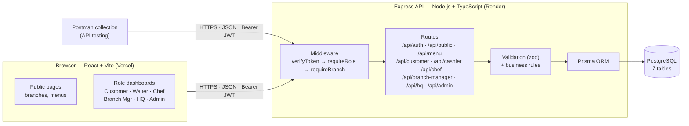
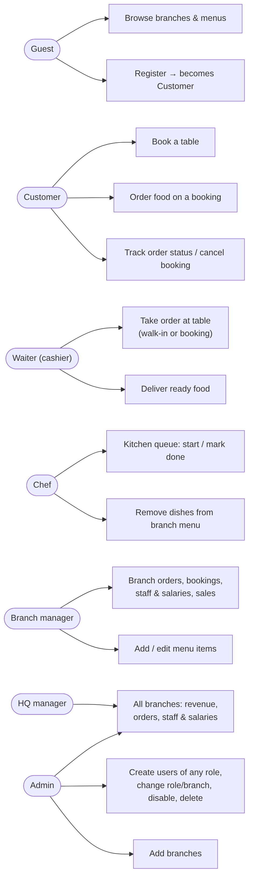
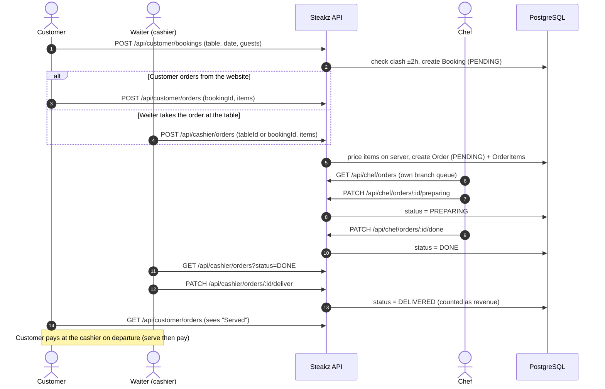
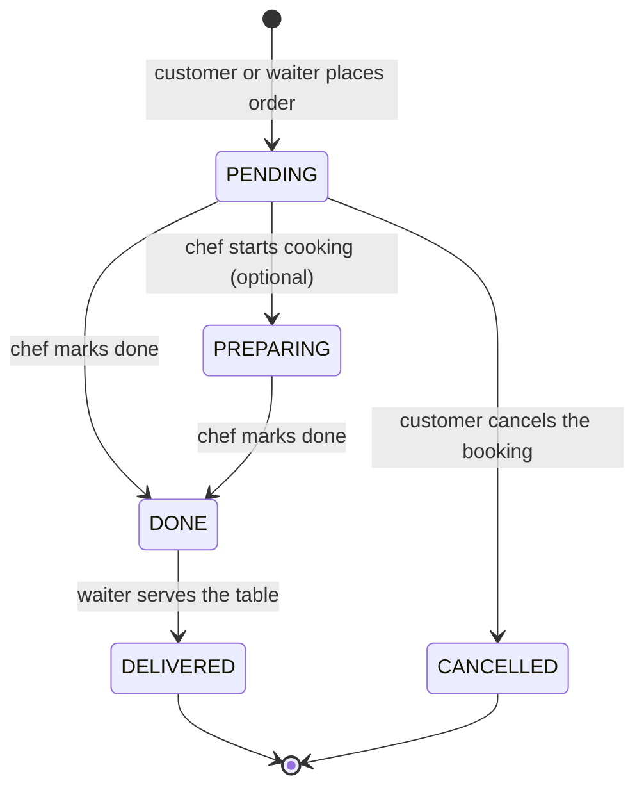
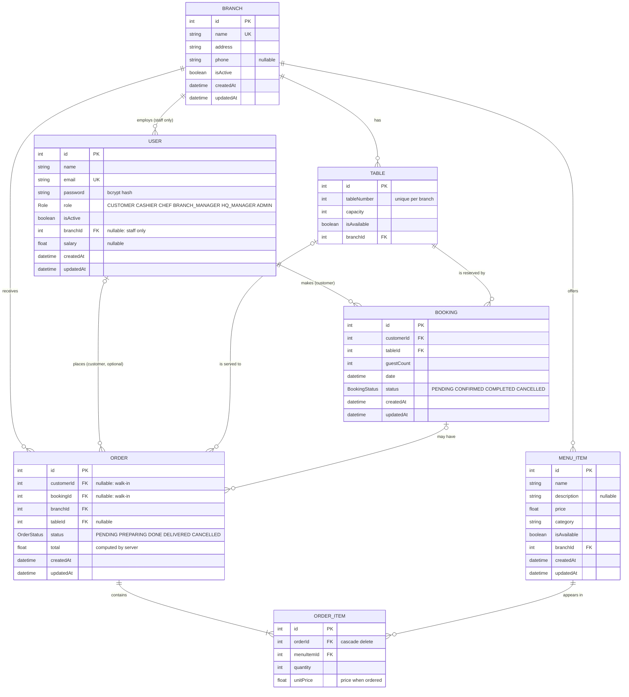
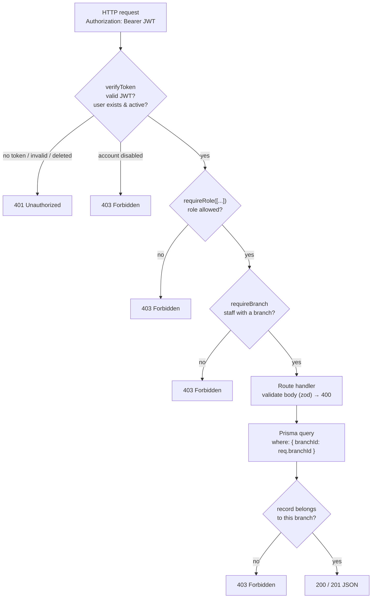

# Steakz Restaurant Portal: application design

This document describes how the system is designed: architecture, roles, business process, data model (Prisma) and how each request is secured. Every diagram is also available as a PNG in [`diagrams/`](diagrams) for slides and the report.

**Contents**

1. [System overview](#1-system-overview)
2. [Architecture](#2-architecture)
3. [Roles and what each one can do](#3-roles-and-what-each-one-can-do)
4. [Business process: from booking to payment](#4-business-process-from-booking-to-payment)
5. [Data model (Prisma / ER diagram)](#5-data-model-prisma--er-diagram)
6. [Security: how every request is checked](#6-security-how-every-request-is-checked)
7. [API design](#7-api-design)
8. [Testing and verification](#8-testing-and-verification)

---

## 1. System overview

Steakz is a chain of 7 steakhouses. The information system supports:

| Business need | How the system supports it |
|---|---|
| Customers reserve tables | Online booking with a live table-availability check (no double booking within 2 hours) |
| Orders reach the kitchen instantly | Customer or waiter submits an order; it appears in that branch's kitchen queue |
| Staff coordinate kitchen and floor | Order status: PENDING → PREPARING → DONE → DELIVERED, visible live to chef, waiter and customer |
| Branch managers run their branch | Daily revenue, table occupancy, bookings, staff roster and salaries, menu management |
| Head office oversees the chain | Revenue per branch, all orders, all staff and salaries across 7 branches |
| Accounts are controlled centrally | Admin creates staff of any role, assigns branches, changes roles, disables or deletes accounts |

**Business rules (from the business process model):** dine-in and table booking only (no delivery). The customer pays **after** eating ("serve then pay"). The **cashier also works as the waiter**: they take the order at the table and deliver the food. Only logged-in customers can book. Staff only ever see their own branch.

## 2. Architecture

A three-tier web application: React client, REST API, relational database.



| Layer | Technology | Responsibility |
|---|---|---|
| Presentation | React 19 + Vite + React Router (Vercel) | Public pages and one dashboard per role; polls every few seconds for live status |
| Application | Node.js + Express 5 + TypeScript (Render) | REST endpoints, authentication (JWT), authorisation middleware, validation (zod), business rules |
| Data access | Prisma ORM | Type-safe queries; every branch-scoped query filters by the user's `branchId` |
| Data | PostgreSQL | 7 tables, enums for roles and statuses, foreign keys and unique constraints |

Source layout (backend):

```
prisma/schema.prisma        data model (7 models, 3 enums)
src/middleware/auth.ts      verifyToken, requireRole, requireBranch
src/routes/                 one router per actor: auth, public, menu, customer, cashier, chef, branch-manager, hq, admin
src/utils/orders.ts         server-side pricing and validation of order items
src/utils/reports.ts        sales and staff reports
src/lib/demoData.ts         all roles + demo data, loaded automatically on first start
postman/                    Postman collection + environments
tests/api.test.ts           324 automated API checks
```

## 3. Roles and what each one can do



| Role | Scope | Main tasks | Demo login (password `password123`) |
|---|---|---|---|
| Guest | none | Browse branches and menus, register | — |
| Customer | own bookings and orders | Book a table, order food on a booking, track status, cancel | `customer@steakz.com` |
| Waiter (cashier) | own branch | Take orders at the table (walk-in or booked guest), deliver ready food | `waiter.london@steakz.com`, `cashier.london@steakz.com` |
| Chef | own branch | Kitchen queue: start cooking, mark done; remove dishes | `chef.london@steakz.com` |
| Branch manager | own branch | Orders, bookings, staff and salaries, sales, add or edit dishes | `manager.london@steakz.com` |
| HQ manager | all branches | Consolidated revenue, orders, staff and salaries | `hq@steakz.com` |
| Admin | everything | Users (any role), branches, menus, plus all HQ reports | `admin@steakz.com` / `admin123` |

Every branch has the same staff accounts (`manager.`, `chef.`, `chef2.`, `waiter.`, `cashier.` followed by `london`, `manchester`, `birmingham`, `leeds`, `liverpool`, `glasgow` or `edinburgh`). **They are created automatically** the first time the server starts on an empty database, so all roles exist before anyone logs in.

## 4. Business process: from booking to payment



**Order status (state machine).** The server rejects any transition not shown here with `400 Bad Request`. For example, a waiter can't deliver an order that the kitchen hasn't finished.



**Booking status:** `PENDING` when booked, then `CONFIRMED` when the waiter serves the guest, then `COMPLETED`. A booking can be `CANCELLED` by the customer, but only while no food for it is being prepared.

## 5. Data model (Prisma / ER diagram)

The model is defined in [`prisma/schema.prisma`](../prisma/schema.prisma): 7 models and 3 enums (`Role`, `BookingStatus`, `OrderStatus`).



| Relationship | Cardinality | Rule |
|---|---|---|
| Branch → User | 1 : 0..* | Only staff (waiter/cashier, chef, branch manager) have a `branchId`. Customer, HQ and admin are global (`null`) |
| Branch → Table | 1 : 0..* | `@@unique([tableNumber, branchId])`: table numbers restart at 1 in each branch |
| Branch → MenuItem | 1 : 0..* | Each branch has its own menu and prices |
| User → Booking | 1 : 0..* | A booking always belongs to a customer, which is why guests can't book |
| Table → Booking | 1 : 0..* | No two active bookings for one table within 2 hours (checked by the API) |
| Booking → Order | 0..1 : 0..* | Walk-in orders have no booking |
| Table → Order | 0..1 : 0..* | Which table the waiter delivers to |
| Order → OrderItem | 1 : 1..* | Cascade delete. `unitPrice` keeps the price at the time of ordering |
| MenuItem → OrderItem | 1 : 0..* | Restrict: a dish that was ever ordered is marked unavailable instead of deleted, to protect sales history |

Design decisions:

- `Order.total` and `OrderItem.unitPrice` are **calculated by the server** from the menu. The client only sends item IDs and quantities, so prices can't be tampered with.
- `Order.branchId` is stored directly (rather than derived from the table) so every kitchen and report query is a single indexed filter: `@@index([branchId, status])`.
- Passwords are stored only as **bcrypt hashes**.

## 6. Security: how every request is checked



- **`verifyToken`** reads the JWT, then reloads the user from the database. A disabled, deleted or re-assigned account loses access immediately, even with an old token.
- **`requireRole([...])`** allows only the listed roles and returns `403` otherwise.
- **`requireBranch`** makes `req.branchId` come from the logged-in account, never from the URL or the request body. Every query uses `where: { branchId }`, and actions on a single record check that the record belongs to that branch. For example, a Manchester chef marking a London order done gets `403`.

| Status | Meaning |
|---|---|
| 400 | Invalid input or a business rule broken (e.g. booking in the past, deliver before DONE) |
| 401 | No token, invalid or expired token, or wrong password |
| 403 | Logged in but the role or branch isn't allowed, or the account is disabled |
| 404 | Record not found |
| 409 | Conflict: duplicate email or branch name, or the table is already booked |

## 7. API design

REST over JSON. Resources are grouped by actor, so the access-control table maps one-to-one onto routers. The full list with access per role is in the [backend README](../README.md#endpoints).

| Router | Middleware chain | Endpoints |
|---|---|---|
| `/api/auth` | none (`/me` uses verifyToken) | register, login, me |
| `/api/public`, `GET /api/menu/:branchId` | none | branches, branch detail (tables + menu), menu |
| `/api/menu` (POST, PATCH) | verifyToken → requireRole([BRANCH_MANAGER, ADMIN]) | add or update dishes |
| `/api/customer` | verifyToken → requireRole([CUSTOMER]) | bookings (list, create, cancel), orders (list, create) |
| `/api/cashier` | verifyToken → requireRole([CASHIER]) → requireBranch | orders (create, list, deliver), today's bookings |
| `/api/chef` | verifyToken → requireRole([CHEF]) → requireBranch | queue, preparing, done, menu, delete dish |
| `/api/branch-manager` | verifyToken → requireRole([BRANCH_MANAGER]) → requireBranch | overview, orders, staff, bookings, sales |
| `/api/hq` | verifyToken → requireRole([HQ_MANAGER, ADMIN]) | overview, orders, staff, sales |
| `/api/admin` | verifyToken → requireRole([ADMIN]) | branches, users, role, disable, enable, delete |

## 8. Testing and verification

| What | How to run | Result |
|---|---|---|
| Postman collection: all endpoints, grouped by role, with tests | Import `postman/*.json` → Collection Runner, or `npm run test:postman` | 59 requests, 92 assertions, all pass |
| Automated access-control matrix + business flow | `npm run test:api` (server running) | 324 checks, all pass |
| End-to-end in the browser (customer, waiter, chef, admin) | Manual or Playwright | Book → order → cook → deliver → served, all pass |
